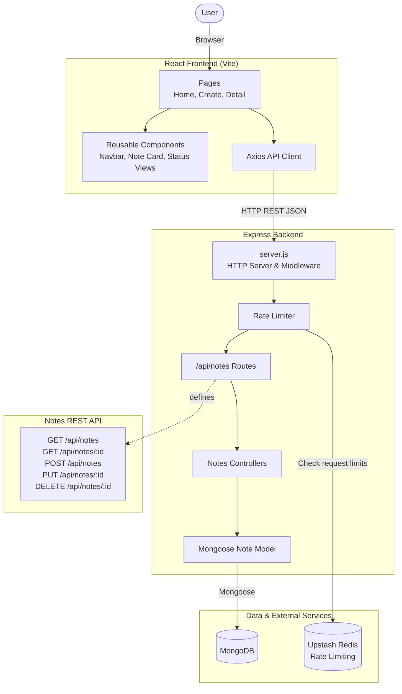

# Architecture Overview

This repository is a MERN-style note-taking application with a React frontend and an Express/MongoDB backend.

## Runtime Flow

1. The user interacts with React pages rendered by Vite.
2. The Axios client sends REST requests to the Express API.
3. Express applies JSON parsing and rate-limiting middleware.
4. Note routes dispatch requests to the controller functions.
5. Controllers use the Mongoose `Note` model for CRUD operations.
6. Mongoose stores and retrieves note documents in MongoDB.

In development, the frontend calls `http://localhost:5001/api`; in production, it uses the same-origin `/api` path and serves the built frontend from Express.
